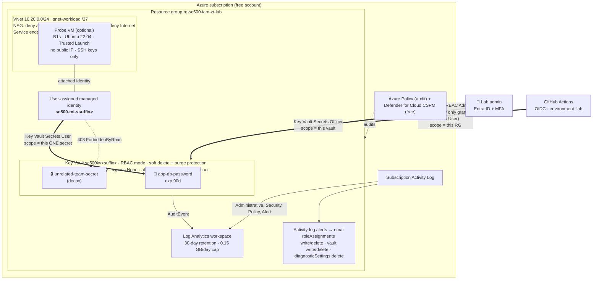

# Architecture

## The one-sentence version

The application has **no password to steal**: it proves who it is with an Azure managed identity,
can read **exactly one secret**, can only reach that secret **from its own subnet**, and every read,
every denial and every permission change is **logged and alerted** — all on free-tier resources.

## Diagram

## Components and why each one is there

| Component | Free? | Why it exists | Key setting |
|---|---|---|---|
| User-assigned managed identity | Free | Gives the workload an identity with **no credential** to store or rotate | Separate from the VM's lifecycle, so it can be pre-authorised and reused |
| Key Vault (Standard) | ~$0.03 per 10k operations → pennies | Central, audited secret store | `enableRbacAuthorization`, purge protection, `defaultAction: Deny`, `bypass: None` |
| Two secrets | Included | The decoy is what makes least privilege *testable* | Both expire in 90 days; values are generated at deploy time and never seen |
| Role assignment on a single secret | Free | Blast radius of a compromised workload = 1 secret | `scope: appSecret`, not `scope: vault` |
| Log Analytics | First 5 GB/month free | Investigation and hunting | 30-day retention (free), daily cap 0.15 GB |
| Activity-log alerts + action group | Free (email) | Know *immediately* when someone escalates, destroys or blinds | 5 watched operations |
| Subscription Activity Log export | Free ingestion | Control-plane history in one queryable place | Administrative, Security, Policy, Alert |
| VNet + NSG + service endpoint | Free | Network-bind the vault to the workload without paying for Private Link | Explicit deny-inbound and deny-Internet-outbound |
| Probe VM (optional) | B1s free 750 h/month for 12 months on a free account | Something real to *be* the workload and run positive/negative tests | No public IP; managed via `run-command` only |
| Azure Policy + Defender CSPM | Free | Continuous, independent check that config hasn't drifted | Audit effects only |
| GitHub Actions + OIDC | Free for public repos | Deployments without a single stored cloud secret | Subject pinned to `environment:lab` |

## Identity design: three principals, three different jobs

| Principal | Authenticates with | Can do | Cannot do |
|---|---|---|---|
| **Workload** (managed identity) | IMDS token (no secret) | `GET app-db-password` | Read decoy, list, write, delete, ARM, Graph |
| **Admin** (Entra user) | Password + MFA | Manage secrets in this vault (Secrets Officer) | — (is also subscription Owner on a free account → RISK-05) |
| **Pipeline** (GitHub OIDC app) | Federated GitHub token, `environment:lab` only | Deploy into this RG; grant **only** Secrets User | Grant any other role, touch other RGs, run from a PR |

Separation of duties: nobody who *uses* the secret can *change who can use* the secret.

## Design decisions (ADR-style)

**ADR-1 — User-assigned over system-assigned identity.**
A user-assigned identity exists before the VM, so the role assignment is created once in Bicep and
survives VM rebuilds. Trade-off: it can be attached to several resources, so attachment is
watched via the Activity Log (`virtualMachines/write`).

**ADR-2 — Scope the role to one secret, not the vault.**
Azure RBAC supports secret-level scope. It costs nothing and turns "the app can read the vault"
into "the app can read one value". The decoy secret proves it.

**ADR-3 — Service endpoint instead of Private Endpoint.**
A Private Endpoint is the gold standard but costs ~$7/month. A service endpoint plus a vault
VNet rule is free and still means a stolen token is useless from the internet. Accepted as RISK-01.

**ADR-4 — `run-command` instead of SSH or Bastion.**
No inbound port is ever opened. Running code on the VM requires an Azure role (VM Contributor) and
is logged in the Activity Log. Bastion is paid. Accepted as RISK-03.

**ADR-5 — Generate secret values inside the deployment.**
`@secure() param … = newGuid()` means no human ever types, sees, or pastes the value; ARM does not
log secure parameters. Redeploying rotates the secret.

**ADR-6 — Audit-only policies.**
Deny policies would block the lab while learning. Audit gives honest compliance evidence,
including the one finding we *expect* (private link).

**ADR-7 — Tests run on the compiled ARM template.**
Asserting on what Azure actually receives catches problems text matching would miss. A mutation
check (break the template → tests must fail) is documented in `docs/lab-journal.md`.

## Cost summary

| Scenario | Expected monthly cost |
|---|---|
| Baseline (no VM) | ≈ $0.00–0.05 (Key Vault operations) |
| With probe VM on a free account (first 12 months) | ≈ $0 (B1s + P6 disk are in the free allowance) |
| With probe VM on Pay-As-You-Go, left running | ≈ $8–12 → **deallocate or tear down** |

Run `scripts/99-teardown.sh` when you're done. The soft-deleted vault costs nothing.
