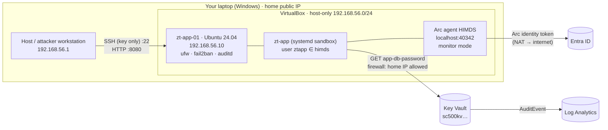

# Hybrid lab — an on-prem server (VirtualBox) running the app, secured into Azure

Real companies don't run everything in Azure. The hard question is: **how does a server in *your*
data centre get a secret from Azure without storing a password on it?** This lab answers it with
**Azure Arc**: the server gets its own managed identity, so the zero-trust design is identical
on-prem and in the cloud.



## Free resources used

| Piece | Cost |
|---|---|
| VirtualBox 7.2 + Ubuntu 24.04 cloud image (SHA-256 **and** GPG verified) | Free |
| Azure Arc-enabled servers (agent, identity, inventory) | Free — we enable **no** paid add-ons |
| Key Vault, Log Analytics, alerts (from `infra/main.bicep`) | ≈ $0 |

## Build it (in order)

```powershell
# 1. VM: imports the OVA, NAT + host-only NICs, cloud-init hardening, boots headless, waits for SSH
powershell -ExecutionPolicy Bypass -File local-lab\create-vm.ps1 -Python <python-with-pycdlib>
```
```bash
# 2. Azure baseline (if not already deployed)
ALERT_EMAIL=you@example.com ./scripts/01-deploy.sh

# 3. Arc-onboard the VM (device-code login with MFA - no service-principal secret)
K=".state/vbox/zt_lab_ed25519"; O="-o UserKnownHostsFile=.state/vbox/known_hosts"
scp -i $K $O local-lab/arc-onboard.sh ztadmin@192.168.56.10:/tmp/
ssh -i $K $O ztadmin@192.168.56.10 "sudo bash /tmp/arc-onboard.sh rg-sc500-iam-zt-lab <sub-id> <tenant-id> eastus"

# 4. Grant the server's Arc identity Secrets User on ONE secret (redeploy with its principal id)
export ARC_PRINCIPAL_ID=$(az resource show -g rg-sc500-iam-zt-lab -n zt-app-01 \
  --resource-type Microsoft.HybridCompute/machines --query identity.principalId -o tsv)
./scripts/01-deploy.sh

# 5. Install the app as a sandboxed service
scp -i $K $O app/zt_app.py app/zt-app.service app/install-on-vm.sh ztadmin@192.168.56.10:/tmp/
ssh -i $K $O ztadmin@192.168.56.10 "sudo bash /tmp/install-on-vm.sh <vault-name>"
curl http://192.168.56.10:8080/secret-check      # {"secret":"app-db-password","length":36,"sha256_12":"…"}

# 6. Attack it
./attacks/run-attacks.sh
```

## Hardening applied to the server (cloud-init → `cloud-init/user-data.yaml`)

| Control | Setting | NIST |
|---|---|---|
| Key-only SSH, no root login, `AllowUsers`, MaxAuthTries 3 | `sshd_config.d/10-zt-hardening.conf` | IA-2, AC-17 |
| Host firewall: inbound only from host-only NIC on 22/8080 | `ufw` | SC-7 |
| Brute-force lockout | `fail2ban` (lab: 2-min ban) | AC-7 |
| Audit identity/sudo changes and Arc token reads | `auditd` rules | AU-2, AU-12 |
| Kernel/network sysctls | `90-zt.conf` | CM-6 |
| Automatic security updates | `unattended-upgrades` | SI-2 |
| Arc agent **monitor mode** (no remote extensions/run-command/SSH via Azure) | `azcmagent config set config.mode monitor` | CM-7 |
| App runs as `ztapp`, no shell, systemd sandbox | `app/zt-app.service` | AC-6, SC-39 |

## How Arc proves "this process is allowed to be the server"

```
app ──GET localhost:40342/…/token──────────────▶ HIMDS
app ◀─401  WWW-Authenticate: Basic realm=/var/opt/azcmagent/tokens/<random>.key
app ──reads that file (only root + group himds can)──┐
app ──GET …/token  Authorization: Basic <file>────────▶ HIMDS ──▶ Entra ID ──▶ token
```
Compare with an Azure VM, where any process that can send `Metadata: true` to
`169.254.169.254` gets a token. Arc adds a **local privilege check** — which is exactly what
attack scenarios A01 and A03 test.
