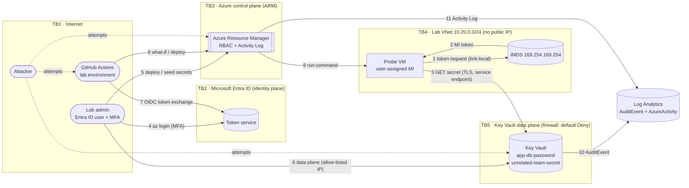

# Threat Model — Azure IAM Zero Trust Lab

> Method: **STRIDE per element** over a data-flow diagram, scored **Likelihood × Impact (1–3 each)**,
> mapped to **MITRE ATT&CK (Cloud)**, **NIST SP 800-53 Rev 5** and **OWASP**.
> Every threat ID below (T01…) is referenced from `controls/control-mapping.csv`, and
> `tests/test_traceability.py` fails the build if a threat has no control or a control points at a
> threat that does not exist.

Last reviewed: 2026-10-28 · Owner: lab author · Review trigger: any change to `infra/` or `.github/workflows/`

---

## 1. Scope

**In scope:** the on-prem workload server (VirtualBox VM, Azure Arc-enabled) and its app, the workload identity, the Key Vault and its two secrets, the optional probe VM and its
network, logging/alerting, the human admin's access, and the GitHub Actions pipeline that deploys it.

**Out of scope:** Microsoft's side of the shared-responsibility line (HSMs, hypervisor, Entra ID
service itself), the attacker owning the admin's laptop outright, and physical attacks.

**What "success" means for an attacker:** read `app-db-password` from anywhere other than the
workload, read *anything else* using the workload's identity, gain more privilege than they started
with, destroy the secrets, or do any of that without being seen.

## 2. Data-flow diagram and trust boundaries



| Boundary | What crosses it | Main control at the boundary |
|---|---|---|
| TB1 → TB2 | Human and pipeline authentication | MFA (security defaults); OIDC federation bound to `repo:…:environment:lab` |
| TB1 → TB3 | Management API calls | Azure RBAC, scoped roles, ABAC condition on the pipeline, Activity Log |
| TB1 → TB5 | Secret reads | Firewall default Deny + IP allow-list, RBAC per secret, AuditEvent |
| TB4 → TB5 | Workload secret read | Service endpoint + VNet rule, MI token, Secrets User on one secret |
| TB4 → TB1 | Egress from the VM | NSG: allow `AzureKeyVault`, `Storage`; deny `Internet` |

## 3. Assets

| ID | Asset | Why it matters | CIA priority |
|---|---|---|---|
| A1 | `app-db-password` | The thing the attacker wants | **C** |
| A2 | `unrelated-team-secret` (decoy) | Represents every *other* secret the workload must not reach | C |
| A3 | Workload managed identity and its tokens | Whoever holds a token *is* the workload | C, I |
| A4 | Role assignments (RBAC) | Changing these changes who can do anything | **I** |
| A5 | Audit logs (AuditEvent, AzureActivity) | Without these, nothing can be investigated | I, A |
| A6 | Pipeline identity (GitHub OIDC app) | Can deploy and grant one role | I |
| A7 | Admin account | Owner of the subscription on a free account | C, I, A |

## 4. Threat actors

| Actor | Capability | Typical entry point |
|---|---|---|
| External attacker | Internet scanning, credential stuffing, reads public repos | Public GitHub repo, Key Vault public endpoint |
| Compromised workload | Code execution on the VM (e.g. vulnerable app dependency) | The VM itself → IMDS token |
| Malicious contributor | Opens a pull request against the repo | `pull_request` workflows |
| Malicious / careless insider | Has some Azure role | Portal / CLI |
| Misconfiguration | Well-meaning change that widens access | Bicep edit, portal click |

## 5. STRIDE analysis

Scoring: **L** = likelihood, **I** = impact, each 1 (low) – 3 (high). **Inherent** = without the lab's
controls, **Residual** = with them.

| ID | STRIDE | Threat (attacker → entry → action → asset) | ATT&CK | Inh. L×I | Controls in this lab | Res. L×I | Verified by |
|---|---|---|---|---|---|---|---|
| T01 | S, I | Attacker reads source/config/env vars and finds a reusable cloud credential → A1 | T1552.001 | 3×3=9 | Managed identity, no secrets in code, secure params with generated values, Gitleaks + hygiene tests | 1×3=3 | `test_repo_hygiene.py`, CI Gitleaks, EVD-003 |
| T02 | S | Compromised workload steals its MI token and replays it from attacker infra → A1 | T1528, T1550.001 | 3×3=9 | Firewall default Deny (token alone is useless off-network), token lifetime ≈ 24h max, AuditEvent with caller IP, hunting query | 2×2=4 | `kv-access-from-unexpected-network.kql`, EVD-009 |
| T03 | E, I | Compromised workload uses its identity to read *other* secrets / enumerate the vault → A2 | T1555.006 | 3×3=9 | Secrets User scoped to **one secret**; no list permission | 1×1=1 | Probes `read_decoy_secret`, `list_secrets` = 403, EVD-007 |
| T04 | E | Attacker with any foothold creates a role assignment to escalate → A4 | T1098.003 | 2×3=6 | Workload has no `roleAssignments/write`; pipeline's RBAC Admin limited by ABAC condition to Secrets User; activity-log alert | 1×2=2 | C2 in `02-verify.sh`, EVD-004, EVD-010 |
| T05 | I | Anyone on the internet calls the vault endpoint directly → A1 | T1190 (exposed service) | 2×3=6 | Firewall default Deny, bypass None, IP allow-list, VNet rule; RBAC still required | 1×3=3 | `test_key_vault_firewall_default_deny`, C6 manual test |
| T06 | D | Attacker or mistake deletes secrets / the vault → A1, A2 | T1485 | 2×3=6 | Soft delete 7d + **purge protection**; workload cannot delete (403); alert on `vaults/delete` | 1×1=1 | `test_key_vault_is_recoverable`, probe `delete_secret` = 403 |
| T07 | R, D | Attacker deletes diagnostic settings to go dark → A5 | T1562.008 | 2×3=6 | Alert on `diagnosticSettings/delete`; Activity Log exported at subscription scope; workload has no rights on the workspace | 2×2=4 | Alert config, `logging-and-vault-tampering.kql` |
| T08 | R | "It wasn't me" — nobody can say who read which secret → A5 | — | 3×2=6 | AuditEvent with object ID, app ID, IP, result; 30-day retention | 1×2=2 | `kv-secret-reads-by-identity.kql`, EVD-009 |
| T09 | S | Long-lived CI secret leaks from GitHub and is used to deploy → A6 | T1552, OWASP CICD-SEC-6 | 3×3=9 | **OIDC federation, zero client secrets**; subject pinned to repo + `lab` environment | 1×2=2 | `05-oidc-github.sh` final check, EVD-010c |
| T10 | T, E | Malicious PR modifies a workflow to deploy or exfiltrate (poisoned pipeline) → A6 | OWASP CICD-SEC-4 | 2×3=6 | CI has `contents: read` and no `id-token`; deploy is `workflow_dispatch` + environment with required reviewer | 1×2=2 | `test_ci_has_no_azure_credentials…`, `test_deploy_uses_oidc…` |
| T11 | S, E | Brute-force / exploit SSH on the VM → A3 | T1110, T1021.004 | 3×3=9 | No public IP, deny-all inbound, password auth off, admin path = `run-command` (RBAC-gated, logged) | 1×2=2 | `test_no_public_ip_anywhere`, C7 |
| T12 | I | Compromised workload exfiltrates the secret to the internet → A1 | T1567, T1537 | 3×3=9 | NSG egress: allow `AzureKeyVault` + `Storage` only, deny `Internet` | 2×3=6 | Probe `internet_egress` = 000 |
| T13 | I | Secret never rotates; an old leak stays valid forever → A1 | T1552 | 2×2=4 | 90-day expiry on every secret; redeploy rotates; policy audits expiry | 1×2=2 | `test_secrets_expire…`, EVD-008 |
| T14 | T | Configuration drift: someone clicks a vault open in the portal → all | T1578 | 2×3=6 | Bicep is the baseline; CI build/lint/Checkov; Azure Policy audit; vault-write alert | 1×2=2 | CI, EVD-001/003/008 |
| T15 | S, E | Admin account phished; attacker inherits Owner → A7 | T1078.004, T1566 | 2×3=6 | MFA (security defaults); daily data-plane access is Secrets Officer on one vault, not Owner | 2×3=6 | EVD-011 (screenshot) |
| T16 | E, I | Insider / compromised low-privilege account on the **on-prem server** asks Arc for the machine's token → A3 | T1528, T1078.003 | 3×3=9 | Arc challenge file readable only by root + `himds`; app runs as dedicated `ztapp` (only non-root `himds` member); no sudo for users; auditd watch on token dir | 1×2=2 | `attacks/run-attacks.sh a01`, `a07` |
| T17 | I, E | **SSRF** in the app is used to reach the local identity endpoint (HIMDS) and steal a token → A3, A1 | T1190 → T1528, OWASP A10 | 2×3=6 | HIMDS answers with a 401 challenge, token needs an `Authorization` header SSRF can't set; HIMDS bound to localhost; vulnerable endpoint off by default. **F-005 (2026-10-28):** `file://` could read the challenge key → fixed with scheme allow-list, resolve-then-block internal IPs, no redirects. Residual: DNS-rebinding TOCTOU between check and fetch | 1×2=2 | `a03` (attack), `a08` (re-test 8/8 blocked), `tests/test_app_ssrf_guard.py` |
| T18 | T | Root on the server re-enables Arc "full" mode / installs extensions to turn Azure into a remote shell → A3 | T1543, T1072 | 2×3=6 | Arc `config.mode monitor`; extension installs from Azure need RBAC + appear in Activity Log; least-privilege identity limits value of the box | 2×2=4 | `azcmagent config list`, Activity Log |

### Attack tree — "read `app-db-password` without being the workload"

```
GOAL: obtain app-db-password
├── 1. Find a credential in code/config ............... blocked: none exists (T01)
├── 2. Call the vault from the internet
│   ├── 2a. with no token ............................. blocked: 401 + firewall (T05)
│   └── 2b. with a stolen MI token .................... blocked: firewall, IP not allowed (T02)
├── 3. Run code ON the workload VM
│   ├── 3a. via SSH ................................... blocked: no public IP / inbound (T11)
│   ├── 3b. via run-command ........................... needs VM Contributor on the RG → logged (T04, T14)
│   └── 3c. via a vulnerable app dependency ........... POSSIBLE → read A1 allowed (by design);
│        ├── exfil to internet ......................... blocked except via Storage tag (T12, RISK-02)
│        └── read other secrets ........................ blocked: 403 ForbiddenByRbac (T03)
├── 4. Grant yourself access (role assignment) ........ blocked unless Owner/UAA; alerted (T04)
├── 5. Abuse the pipeline ............................. no stored secret; env approval (T09, T10)
└── 6. Phish the admin ................................ MFA; residual risk (T15, RISK-05)
```

The only path that still works is 3c: an attacker running code *as the workload* can read
*the workload's own secret*. That is unavoidable by design (the app has to read it). What the lab
achieves is that the blast radius is **one secret**, it cannot leave over the internet easily, and
every read is logged with the caller's IP.

## 6. Residual risk register

| ID | Risk | Why accepted | Compensating controls | Upgrade path (paid) |
|---|---|---|---|---|
| RISK-01 | Vault `publicNetworkAccess = Enabled` (Checkov CKV_AZURE_189, policy "use private link") | Private Endpoint ≈ $7/month; free lab | Default Deny, bypass None, IP allow-list, VNet service endpoint | Private Endpoint + Private DNS zone, `publicNetworkAccess: Disabled` |
| RISK-02 | `Storage` service tag allows egress to *any* storage account (exfil path) | Needed for VM agent/run-command packages | Short-lived lab, logging, single secret blast radius | Azure Firewall with FQDN rules, or storage-region tags only |
| RISK-03 | VM extensions allowed (CKV_AZURE_50) | `run-command` replaces SSH entirely | RBAC-gated, Activity Log records every invocation | Azure Bastion / JIT, or no VM (Container Apps / Functions with MI) |
| RISK-04 | No encryption at host (CKV_AZURE_97/151) | Feature flag + SKU support | Managed disks encrypted at rest by the platform (SC-28) | Register `EncryptionAtHost`, enable in `securityProfile` |
| RISK-05 | Admin is subscription Owner on a free account, no PIM | PIM needs Entra ID P2 | MFA, separate low-privilege vault role for daily work, alerts | Entra ID P2 trial → PIM eligible assignments, Conditional Access |
| RISK-06 | MI tokens are bearer tokens valid up to ~24h | Platform behaviour | Network restriction makes stolen tokens useless off-VNet | Continuous Access Evaluation (where supported), shorter-lived workload |
| RISK-07 | `ztadmin` has passwordless sudo on the on-prem server | Lets scripts automate the lab | Key-only SSH from the host-only network, fail2ban, auditd on sudoers | Require sudo password / use a PAM MFA module; break-glass account only |
| RISK-08 | On-prem server egresses through a home NAT: the vault IP allow-list trusts **every** device on that network, and egress is unfiltered | No free way to give a home VM a dedicated IP | Secret-scoped RBAC limits what a replayed token reads; reads logged with caller IP and identity | Site-to-site VPN + Private Endpoint, or a dedicated egress IP / proxy with allow-list |

## 7. Assumptions

- Microsoft-managed components (Entra ID, IMDS, Key Vault HSMs) behave as documented.
- The admin's workstation is not already compromised.
- The lab holds **synthetic** data only; secret values are random GUIDs nobody ever sees.

## 8. How to re-run this threat model

1. Change something in `infra/` or the workflows.
2. Walk the DFD: did a flow or boundary change? Add or edit rows in §5.
3. Every new threat needs at least one row in `controls/control-mapping.csv` (CI enforces it).
4. Re-run `scripts/02-verify.sh` and `scripts/04-evidence.sh` so the evidence matches the design.
